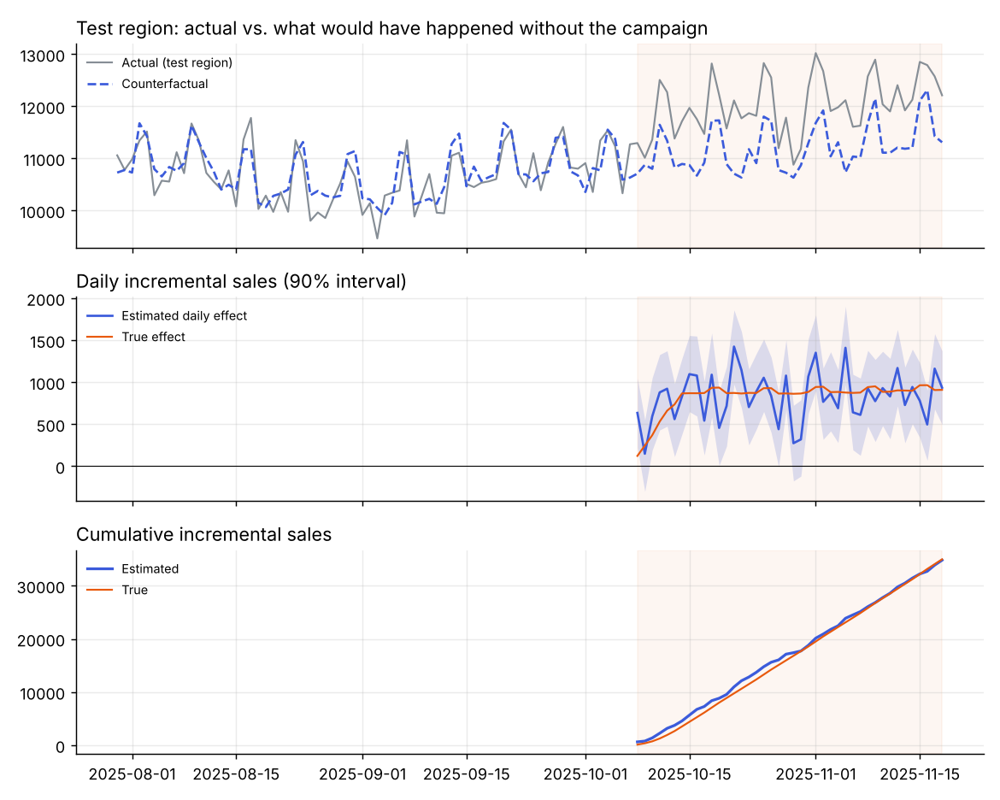
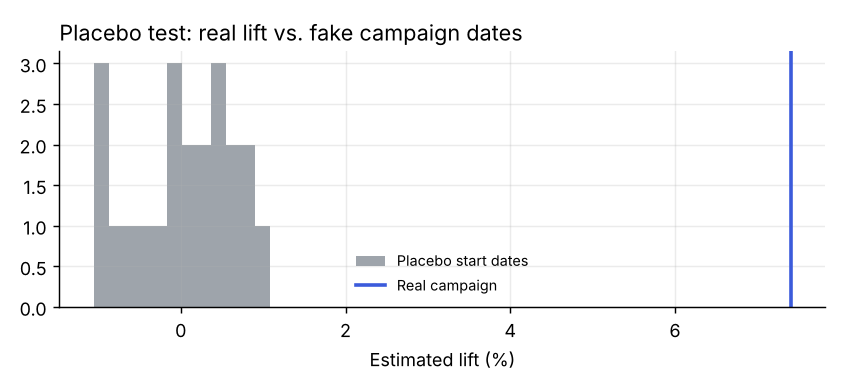
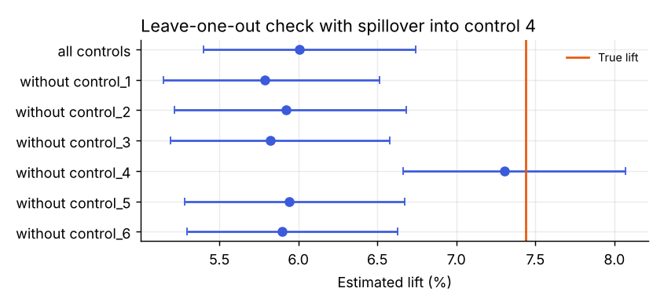

# Did the campaign work?

Measuring the incremental effect of a regional marketing campaign with a synthetic control: build a counterfactual for the test region from regions that did not get the campaign, compare, and stress-test the result.

The data is synthetic with a known true lift, so every estimate can be checked against the truth.

**Start here:** [notebooks/campaign_walkthrough.ipynb](notebooks/campaign_walkthrough.ipynb) goes from the business question to the decision, including the checks that tell you when not to trust the number.



## The story in four numbers

| | |
|---|---|
| **+12.8%** | what a naive before/after comparison says. Autumn sales were rising anyway |
| **+7.40%** | the synthetic-control estimate (90% interval +6.77% to +8.15%) |
| **+7.44%** | the true lift |
| **1.74** | incremental ROAS. The campaign worked, but at a 40% margin it did not pay for its €20k cost |

## Approach

1. **Counterfactual.** On the pre-campaign period, the test region is regressed on six control regions: an intercept plus non-negative weights, so the counterfactual is a blend of real regions rather than an arbitrary linear fit.
2. **Effect.** Actual minus counterfactual during the campaign, per day and cumulated.
3. **Uncertainty.** Pre-period residuals are resampled in weekly blocks to put a 90% interval around the counterfactual.
4. **Placebo test.** The same analysis on 22 fake start dates in the pre-period, where the true effect is zero. All of them stay within ±1.1%; the real lift is around 7%.
5. **Sensitivity.** Each control region is left out in turn. A robust result barely moves.



## When it breaks: spillover

The most common failure is a control region that the campaign also reached (national TV, broad online targeting). Simulating 60% spillover into control 4 drags the estimate down to about 6%, and its interval misses the truth. The leave-one-out check exposes it immediately: dropping control 4 brings the estimate back.



## Run it

```bash
pip install -r requirements.txt
make demo        # charts + results.md
make test        # unit tests
```

`causal/impact.py` works on any daily DataFrame with a `date` column, one test series and several control series: `estimate_impact`, `placebo_test` and `control_sensitivity`.

## Before trusting a number like this

- **Check the pre-period fit.** If the controls don't track the test region before the campaign (here MAPE ≈ 2%), stop there.
- **Look at the placebo distribution.** The real effect should sit clearly outside it.
- **Run the leave-one-out check.** One region moving the answer is a red flag for spillover or a local shock.
- **Separate "worked" from "worth it".** Incremental revenue needs to be weighed against cost and margin, not just tested for significance.

## License

MIT
